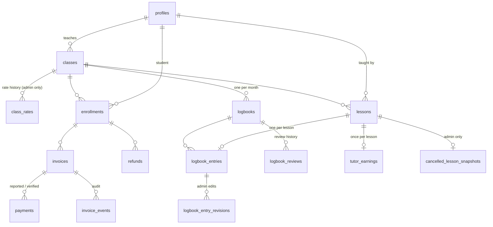

# Architecture

```
Browser ──> Next.js (App Router, Server Components + Server Actions), signed-in user's session only
              ▼
            Supabase: Auth · REST (PostgREST) · PostgreSQL · Storage · pg_cron     every business rule lives here
```

**Reads go through Row Level Security; writes go through database functions.** Supabase exposes the database over a
REST API any signed-in user can call, so a rule that exists only in Next.js can be bypassed. Every table has RLS with
`SELECT` policies only, so a direct write is refused. Every change is a `SECURITY DEFINER` function that checks the
caller's role first, locks what it touches and does one narrow job; constraints and triggers are the second line of
defence. Next.js only validates forms and redirects by role to give friendly errors: the database is what refuses.
The app never uses the service role key.

## Data model



Money is `bigint` rupiah and durations are integer minutes (90 min at Rp100,000/h is exactly Rp150,000). Times are
`timestamptz`; WIB (UTC+7) exists only at the edges (`src/lib/time.ts`, and `lesson_month()` for the month a lesson
belongs to). **Nothing derivable is stored:** hours left are replayed from payments and lessons (`_ledger`), so a
cancelled lesson returns its hours and the figure cannot drift.

## Where each rule is enforced

| Rule | Enforced by |
|---|---|
| No duplicate enrollment | partial unique index `enrollments_one_live_per_student`; `enroll_in_class` |
| Capacity never exceeded, even in parallel | trigger `enrollments_capacity_guard` (locks the class row); tested with parallel requests |
| End after start; a tutor's lessons never overlap | `lessons_end_after_start`; exclusion constraint `lessons_no_tutor_overlap` |
| A submitted or approved month is frozen; a lesson is changed only by its own tutor or an admin | trigger `lessons_month_lock`; `can_change_lesson` (`cancel_lesson`, `update_lesson_time`) |
| One logbook per class per month, one entry per lesson, four required fields, entries only after the lesson ended | `unique (class_id, month)`, `unique (lesson_id)`, `check`, trigger `entries_validity_check` |
| Only admins approve; an approved logbook is read-only | `approve_logbook` (`require_admin`); triggers `entries_lock_check`, `logbooks_approved_check` |
| Earnings once per lesson; approving again adds nothing | `approve_logbook` (row lock) + unique `tutor_earnings.lesson_id` + `on conflict do nothing` |
| Students see only paid classes, tutors only their own; logbooks hidden until approved, through the API too | RLS `classes_*`, `lessons_student` (needs an `active` enrollment), `logbooks_student` / `entries_student` (approved only) |
| Only admin and that tutor see earnings; tutors never see student rates | `earnings_*` policies; rates live in `class_rates`, admin-only (RLS filters rows, not columns) |
| A student cannot mark an invoice Paid; the price is a snapshot | no write policies, admin-only `verify_payment`; `invoices_amount_matches` (`amount = hours × rate`) |

Time-dependent behaviour (24 hour payment window, renewal at 3 hours or less, seat release after 7 days) lives in
`run_scheduled_jobs(p_now)`, run by `pg_cron` every 5 minutes; it takes the clock as a parameter so tests simulate
time. Notifications and the waitlist are driven by `AFTER` triggers, so no code path can forget to notify or to hand a
freed seat on: the first student on the waitlist is enrolled the moment a seat frees up, through the same function
(`_enroll_student`) a student enrolling uses.

`tests/db` signs in as real users and calls the REST/RPC API (parallel enrollment for the last seat, concurrent
approval, a student reading a draft logbook, a tutor reading rates, direct writes, time-travelled expiry); `tests/unit`
covers the pure helpers. Every security fix found in review has a test that failed first.

## Design system

Tokens are defined once as Tailwind v4 `@theme` variables in `src/app/globals.css` (Navy `#2F3F5F`, Gold `#F1C019`,
Surface `#FAFDFF`, Cloud `#E0E2E7` / `#6E7585`, Success `#0AB848`, Destructive `#FF2819`, DM Sans via `next/font`, 6px
card radius); components never use raw hex. `src/components/ui/` is a small kit on those tokens: `Button`,
`Card`/`StatTile`/`PageHeader`, `Table`, `Badge`, `Field` inputs with a Gold focus border, `ActionForm`,
`ConfirmDialog`, `SubmitButton` (disables itself while processing, so a double click cannot repeat an action) and
`Countdown`; `src/components/shell/` holds the Navy sidebar with a Gold active pill. Status colours are decided in one
place, `src/lib/status.ts`: Paid/Approved/Active are Success, Overdue/Rejected/Out of hours Destructive, things
waiting on someone Gold, inactive states muted.

*Trade-off:* badges use the brief's exact colours as solid fills, and white text on `#0AB848` / `#FF2819` is below
WCAG AA for small text, so badge text is bold and slightly larger. A production version would darken those fills.
