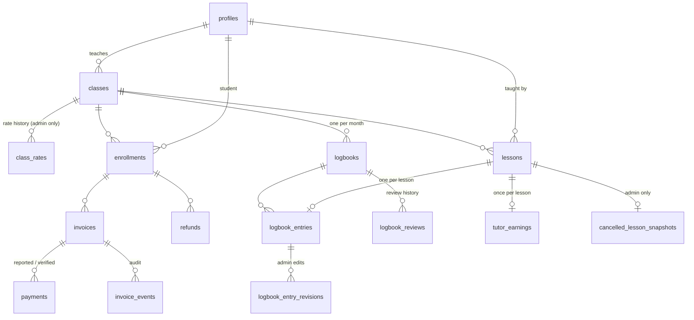

# Architecture

## How it fits together

```
Browser ──> Next.js (App Router, Server Components + Server Actions)
              │  signed-in user's session only (anon key + JWT). The service role key is never used by the app.
              ▼
            Supabase: Auth · REST API (PostgREST) · PostgreSQL · Storage · pg_cron
                      └─ all business rules live here
```

**Reads go through Row Level Security; writes go through database functions.** Supabase exposes the database
over a REST API that any signed-in user can call directly, so a rule that only exists in Next.js can be
bypassed. Every table has RLS with `SELECT` policies only. There are no insert/update/delete policies, so a
direct write is refused. Every change is a `SECURITY DEFINER` Postgres function that checks the caller's role
first, locks what it touches and does one narrow job. Constraints and triggers sit underneath as a second
line of defence. Next.js validates forms and the pages check the role too, but only to give friendly errors
and redirects; the database is what actually refuses.

## Data model



Money is `bigint` rupiah and durations are integer minutes, so there is no rounding drift (90 min × Rp100,000 /
60 = Rp150,000 exactly). Times are `timestamptz`; WIB (Asia/Jakarta, UTC+7) exists only at the edges
(`src/lib/time.ts` for form input and display, `lesson_month()` for the month a lesson belongs to).
**Nothing derivable is stored:** hours left are replayed from payments and lessons (`_ledger`), so cancelling a
lesson hands the hours back automatically and the figure can never drift.

## Where each rule is enforced

| Rule | Enforced by (migration → object) |
|---|---|
| No duplicate enrollment | `core_tables` → partial unique index `enrollments_one_live_per_student`; `fn_enrollment` → `enroll_in_class` |
| Capacity never exceeded, even for simultaneous requests | `fn_enrollment` → trigger `enrollments_capacity_guard` (locks the class row, counts held seats); tested with parallel requests |
| End after start; a tutor's lessons never overlap | `core_tables` → `lessons_end_after_start`, exclusion constraint `lessons_no_tutor_overlap`; `fn_lessons` → `create_lesson` |
| Times in WIB | `src/lib/time.ts` (input) + `lesson_month()` (month of a lesson) |
| One logbook per class per month; one entry per lesson; four required fields | `core_tables` → `unique (class_id, month)`, `unique (lesson_id)`, `check (btrim(...) <> '')` |
| Entry only for a lesson that has ended | `fn_logbooks` → trigger `entries_validity_check` |
| Only admins approve; approved logbook is read-only | `fn_earnings` → `approve_logbook` (`require_admin`); `fn_logbooks` → triggers `entries_lock_check`, `logbooks_approved_check` |
| Students see only paid classes; tutors only their own | `helpers_rls` → policies `classes_*`, `lessons_student` (needs an `active` enrollment) |
| Logbooks hidden from students until approved, through the API too | `helpers_rls` → `logbooks_student`, `entries_student` (status = approved) |
| Earnings once per lesson; approving again adds nothing | `fn_earnings` → `approve_logbook` (row lock, early return) + `tutor_earnings.lesson_id` unique + `on conflict do nothing` |
| Only admin and that tutor see earnings; tutors never see student rates | `helpers_rls` → `earnings_*`; rates live in `class_rates`, readable by admin only (RLS filters rows, not columns) |
| A student cannot mark an invoice Paid | no write policies; `fn_payments` → `verify_payment` is admin-only and checks the amount and state |
| Invoice price is a snapshot | `core_tables` → `invoices_amount_matches` (`amount = hours × rate_per_hour`) |

Time-dependent behaviour (24 hour payment window, renewal at ≤ 3 hours, seat release after 7 days) lives in
`run_scheduled_jobs(p_now)` (`fn_lifecycle`), run by `pg_cron` every 5 minutes. It takes the clock as a
parameter so tests can simulate time instead of waiting.

## Tests

`tests/db/*.test.ts` sign in as the seeded or freshly created users and call the real REST/RPC API: parallel
enrollment for the last seat, double and concurrent approval, a student reading a draft logbook, a tutor
reading rates, direct writes to tables, payment reversal, time-travelled expiry and so on. `tests/unit` covers
the pure helpers. Every security-relevant fix found during review has a test that failed first.

## Design system

Tokens are defined once as Tailwind v4 `@theme` variables in `src/app/globals.css`: Navy `#2F3F5F`, Gold
`#F1C019`, Surface `#FAFDFF`, Cloud `#E0E2E7` / `#6E7585`, Success `#0AB848`, Destructive `#FF2819`, DM Sans via
`next/font`, 6px card radius. Components never use raw hex values.

`src/components/ui/` is a small kit built on those tokens: `Button` (primary Navy, secondary outlined,
destructive red-outlined), `Card`/`StatTile`/`PageHeader`, `Table`, `Badge`, `Field`/`Input`/`Select`/`Textarea`
(light filled inputs with a Gold focus border), `ActionForm`, `ConfirmDialog`, `SubmitButton` (disables itself
while a form is processing, so a double click cannot repeat an action) and `Countdown`.
`src/components/shell/` holds the grouped Navy sidebar with a Gold active pill. Status colours are decided in one
place, `src/lib/status.ts`: Paid/Approved/Active use Success, Overdue/Rejected/Out of hours use Destructive,
things waiting on someone use Gold, finished or inactive states are muted.

*Trade-off:* the badges use the brief's exact colours as solid fills. White text on `#0AB848` and `#FF2819` is
below the WCAG AA contrast ratio for small text, so badge text is bold and slightly larger. A production
version would darken those two fills for text use or switch the badge to dark text on a tinted background.
